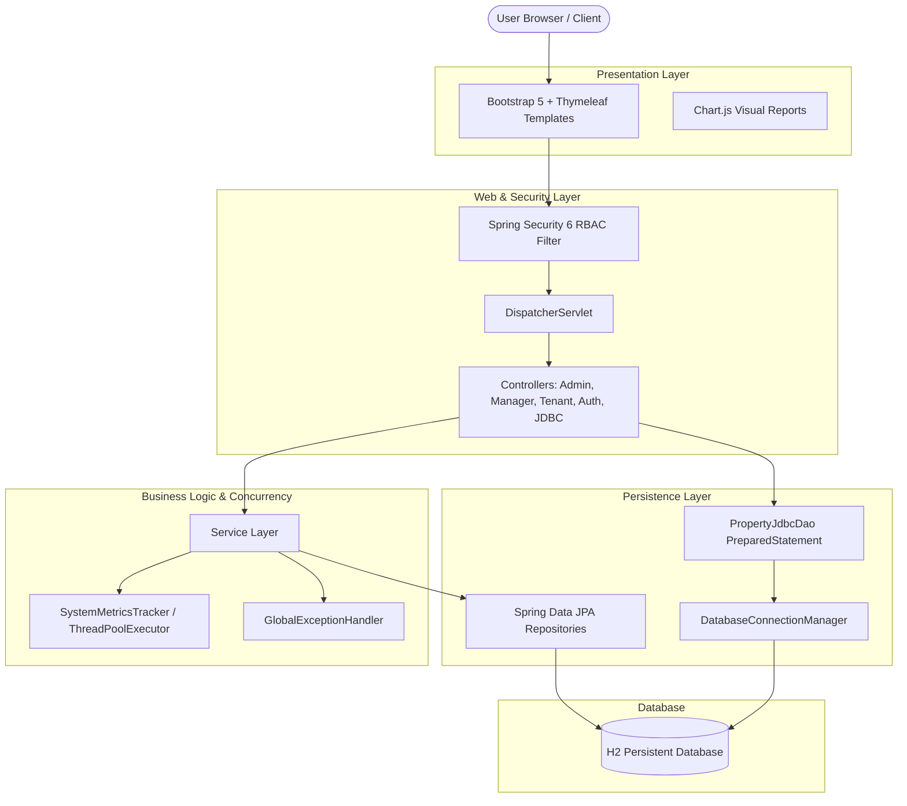
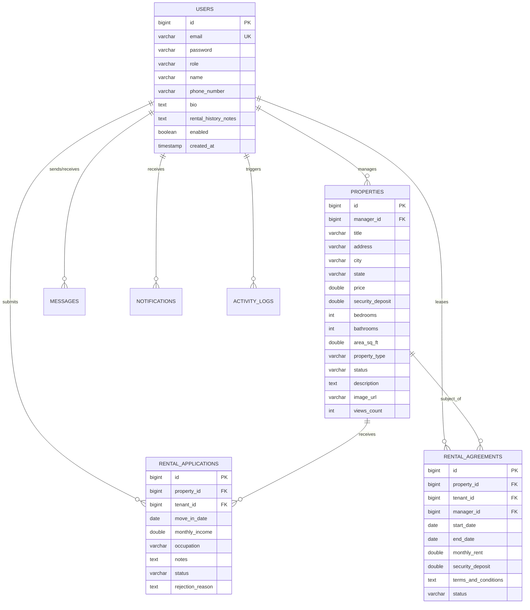

# 📊 Presentation File & Script: Online Real Estate Management System
> **Second Year B.Tech Academic Project - Review 1**  
> **Student:** Lalit Kumar &bull; **Repository:** Local & GitHub  

---

## 🎯 Review 1 Focus Areas Covered
1. **Project Structure & Planning**: Multi-tier layered architecture (Presentation &rarr; Controller &rarr; Service &rarr; DAO &rarr; Database).
2. **Database Design & ER Modeling**: Normalized 3NF schema, relational integrity, primary/foreign keys.
3. **Database Connectivity (JDBC & JPA)**: Pure JDBC DAO (`PreparedStatement`, `ResultSet`, `Connection`, `commit`/`rollback`) alongside Spring Data JPA.
4. **UI/UX Aesthetics & Responsiveness**: 3 distinct, secure role-based dashboards (Admin, Manager, Tenant) built with Bootstrap 5 and Chart.js.
5. **Marking Rubric Alignment**:
   - **OOP Implementation (10 marks)**: Inheritance (`BaseEntity`), Polymorphism (`getEntitySummary()`), Exception Handling (`GlobalExceptionHandler`), Interfaces.
   - **Collections & Generics (6 marks)**: `ApiResponse<T>`, Generic Repositories, Streams API.
   - **Multithreading & Synchronization (4 marks)**: `SystemMetricsTracker` using `AtomicLong`, `synchronized` blocks, `ThreadPoolExecutor`.
   - **Database Operations (JDBC) (10 marks)**: `DatabaseConnectionManager`, `PropertyJdbcDao`, `PreparedStatement`.
   - **Problem Understanding & Solution Design (8 marks)**: Solution architecture and role-based workflows.
   - **Servlets & Web Integration (7 marks)**: Spring MVC `DispatcherServlet`, Security filter chains.

---

## 🖥️ Slide-by-Slide Presentation Transcript

### Slide 1: Title & Introduction
- **Title**: Online Real Estate Management System
- **Subtitle**: B.Tech 2nd Year Project &bull; Review 1
- **Focus**: Project Planning, Architectural Design, Database Modeling, JDBC Integration &amp; UI Aesthetics.
- **Presenter**: Lalit Kumar (2nd Year B.Tech)

---

### Slide 2: Problem Statement & Proposed Solution
- **The Problem**:
  - The conventional rental landscape is fragmented and heavily reliant on disconnected phone calls, unverified broker listings, and physical paperwork.
  - Absence of quality control leads to misleading property listings and price volatility.
  - Lack of auditability leaves tenants and property managers vulnerable to dispute.
- **The EstateHub Solution**:
  - A unified, secure web ecosystem connecting **Administrators**, **Property Managers**, and **Tenants**.
  - **Quality Assurance**: Every listing submitted by a manager must undergo administrative review (approval/rejection with feedback) before being published.
  - **Digital Tenancy Lifecycle**: Search &rarr; Apply Online &rarr; Review Application &rarr; Issue Binding Agreement &rarr; In-App Messaging.

---

### Slide 3: System Architecture


---

### Slide 4: Relational Database Schema & ER Diagram


---

### Slide 5: Database Connectivity & Pure JDBC Integration
- **DatabaseConnectionManager**: Provides standard `java.sql.Connection` via `DriverManager.getConnection()` and Spring's `DataSource`.
- **PropertyJdbcDao**:
  - `findPropertiesByPriceRange(min, max)`: Uses `PreparedStatement` with bind variables (`?`) to prevent SQL injection and processes records via `ResultSet`.
  - `getFinancialSummaryJdbc()`: Executes aggregate SQL (`COUNT`, `SUM`, `AVG`, `MAX`, `MIN`) over live properties.
  - `updatePropertyViewsBatch()`: Illustrates manual JDBC transaction control (`conn.setAutoCommit(false)`, `conn.commit()`, and `conn.rollback()`).
- **Live Test URL**:
  - `GET http://localhost:8080/api/jdbc/metrics`
  - `GET http://localhost:8080/api/jdbc/filter?min=1000&max=3000`

---

### Slide 6: Core Java & OOP Implementation
1. **Inheritance & Polymorphism**:
   - `BaseEntity.java`: Superclass defining common ID, audit timestamps, and an abstract method:
     ```java
     public abstract String getEntitySummary();
     ```
   - Polymorphically implemented across `User.java` and `Property.java`.
2. **Exception Handling**:
   - Hierarchical custom domain exceptions extending `RealEstateException`:
     - `ResourceNotFoundException`
     - `UnauthorizedActionException`
     - `DuplicateResourceException`
   - Centrally handled via `GlobalExceptionHandler` with `@ControllerAdvice`.
3. **Collections & Generics**:
   - Generic response container `ApiResponse<T>` providing standardized API packaging.
   - Heavy usage of `List<T>`, `Map<K, V>`, and Java Streams (`filter`, `map`, `sorted`, `collect`).

---

### Slide 7: Multithreading & Synchronization
- **SystemMetricsTracker**:
  - `AtomicLong` & `AtomicInteger`: Non-blocking, thread-safe counter tracking for page visits, searches, and active user sessions.
  - `synchronized`: Thread-safe monitor lock on metric reset methods.
  - `ThreadPoolExecutor`: Asynchronous worker pool (core size 2, max size 4, bounded queue) offloading background notification and audit operations without blocking the HTTP request thread.

---

### Slide 8: UI/UX Aesthetics & Responsiveness
- **Clean Aesthetic Palette**: Styled with Google's *Plus Jakarta Sans* typography, elevated cards with subtle box-shadows, and contextual status badges (`Pending`, `Approved`, `Active`, `Rented`).
- **Mobile-First Responsive Grid**: Powered by Bootstrap 5.3, tested across viewport dimensions from mobile devices to desktop monitors.
- **Interactive Visual Data**: Chart.js charts dynamically render property status distributions and registered user demographics.

---

### Slide 9: Role-Based Dashboard Comparison

| Feature / Role | Tenant Portal | Property Manager Portal | Administrator Portal |
| :--- | :---: | :---: | :---: |
| **Browse / Search Listings** | ✅ Multi-criteria filter | ✅ View all | ✅ View & moderate |
| **Submit Listing** | ❌ | ✅ CRUD listings | ❌ |
| **Approve / Reject Listing** | ❌ | ❌ | ✅ Full authority |
| **Apply for Rental** | ✅ Online application | ❌ | ❌ |
| **Review Applications** | ❌ | ✅ Accept / Reject | ❌ |
| **Issue Lease Agreement** | ❌ | ✅ Issue & Terminate | ❌ |
| **Direct Messaging** | ✅ With managers | ✅ With tenants | ❌ |
| **Activity Monitoring** | ❌ | ❌ | ✅ Real-time audit log |
| **System Settings** | ❌ | ❌ | ✅ Full configuration |

---

### Slide 10: Live Demonstration & Viva Ready Setup
- **Server Running at**: `http://localhost:8080`
- **H2 Web Database Console**: `http://localhost:8080/h2-console`
- **Pre-Seeded Accounts with 1-Click Login**:
  - Admin: `admin@realestate.com` / `admin123`
  - Property Manager: `manager@realestate.com` / `manager123`
  - Tenant: `tenant@realestate.com` / `tenant123`

---

### Slide 11: Future Milestones (Review 2 & Beyond)
- Integration with payment gateway (Stripe/Razorpay) for rent transfers.
- Canvas-based electronic signature verification on lease contracts.
- Automated email and SMS dispatch using JavaMailSender and Twilio.
